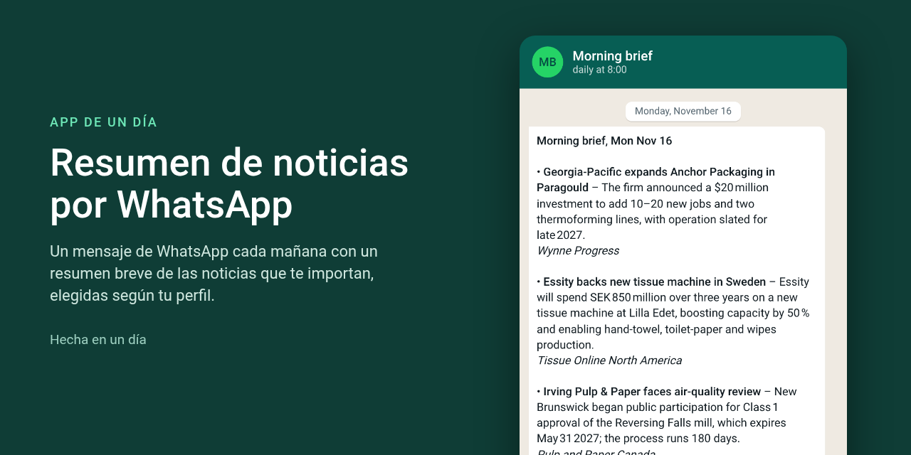

# Apps de un día

[English](README.md) · **Español**

Aplicaciones chicas y completas, cada una hecha, probada y puesta en marcha en un solo día por mí,
[Cristian Desivo](https://cristiandesivo.com/es/).

Cada app tiene su propia página con el pedido del cliente tal como lo escribió, qué se hizo, cómo funciona, e
imágenes. El código queda privado.

## Las apps

| | |
|---|---|
|  | **[Resumen de noticias por WhatsApp cada mañana](apps/morning-news-whatsapp/README.es.md)** Un mensaje de WhatsApp cada mañana con un resumen breve de las noticias que te importan, elegidas según tu perfil. 16 nov 2026 · USD 0 al mes |

## Cómo se hace una app en un día

1. **Pedido:** qué tiene que hacer, qué queda afuera, y cómo sabemos que está terminada.
2. **Desarrollo:** la app se hace y se prueba contra el pedido.
3. **Entrega:** el código, los pasos de instalación y la documentación, puesta en marcha si necesita un servidor.

Si algo no entra en un día, se recorta antes de empezar, no después.

## ¿Querés una?

Hago apps a medida como estas en un día: USD 100 si corre de tu lado, USD 200 si corre en la nube.
[Mandá tu pedido](https://cristiandesivo.com/es/apps-en-un-dia/).
