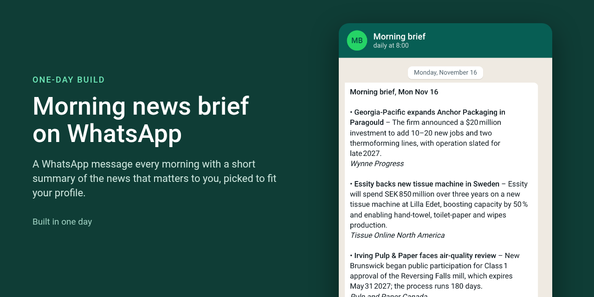

# One-day builds

**English** · [Español](README.es.md)

Small, complete applications, each built, tested and deployed in a single day by me,
[Cristian Desivo](https://cristiandesivo.com).

Each app has its own page with the client's prompt as written, what was built, how it works, and media. The code
itself stays private.

## The apps

<!--
Card format, newest first. Each app lives in apps/<name>/ with README.md, README.es.md and media/:
|  | **[App name](apps/NAME/)** One-line description DATE · monthly cost |
-->

| | |
|---|---|
|  | **[Morning news brief on WhatsApp](apps/morning-news-whatsapp/)** A WhatsApp message every morning with a short summary of the news that matters to you, picked to fit your profile. 16 Nov 2026 · $0 a month to run |

## How a one-day build works

1. **Brief:** what it should do, what's out of scope, and how we'll know it's done.
2. **Build:** the app is built and tested against the brief.
3. **Deliver:** the code, setup steps and documentation, deployed if it needs a server.

If something doesn't fit in a day, it gets cut before the build starts, not after.

## Want one?

I build custom apps like these in a day: 100 USD if it runs on your side, 200 USD if it runs in the cloud.
[Send your request](https://cristiandesivo.com/apps-in-a-day/).
