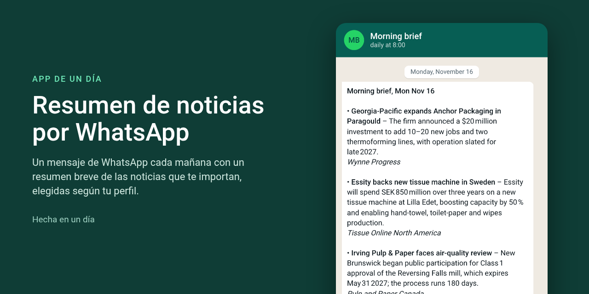
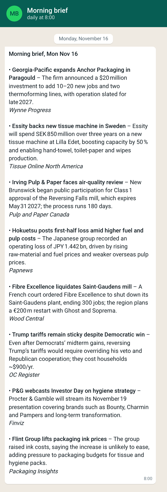
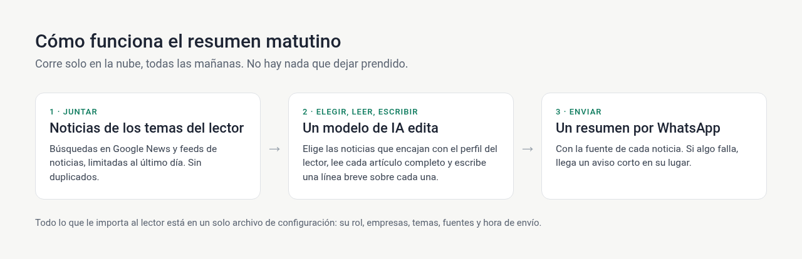

# Resumen de noticias por WhatsApp cada mañana

[English](README.md) · **Español**

Un mensaje de WhatsApp cada mañana con un resumen breve de las noticias que te importan, elegidas según tu perfil.



**Hecha en un día** · 16 nov 2026 · USD 0 al mes

## El pedido

> Quiero una app que todos los días a la mañana me mande un WhatsApp con un resumen breve de las noticias relevantes para mí.

## Qué hace

- Cada mañana junta las noticias del último día sobre los temas del lector.
- Un modelo de IA elige las noticias que le importan a este lector, lee los artículos completos y escribe una línea
  breve sobre cada una, con la fuente y un link.
- Manda el resumen por WhatsApp. Si algo falla, llega un mensaje corto de aviso, así una falla nunca se confunde con
  un día sin noticias.

## Un resumen real

Escrito por la app el día en que se hizo, para un perfil de prueba: un gerente de una papelera de EE. UU. que trabaja
con papel tissue y productos de higiene, y sigue los precios de la celulosa, la competencia, las plantas nuevas y
los cierres, el comercio minorista y las marcas propias, los costos, los aranceles y la regulación. El perfil está
en inglés, así que el resumen también. En esta imagen no aparece el link de cada noticia.



<details>
<summary>El perfil completo, tal como está en la configuración (en inglés)</summary>

```
I am a manager at a US pulp and paper company, focused on tissue (bath tissue,
paper towels, napkins, facial) and sanitary/hygiene products (diapers, feminine
care, adult incontinence, wipes). I care about:
- Pulp markets: NBSK, hardwood/eucalyptus (BEK) and fluff pulp prices, supply, mill outages
- Competitors and big players: Kimberly-Clark, P&G (Charmin, Bounty, Pampers),
  Georgia-Pacific, Essity, Clearwater Paper, Sofidel, First Quality, Cascades,
  Kruger, Irving, Suzano, CMPC, Domtar/Paper Excellence, Mercer, Resolute
- New tissue machines, capacity additions, mill closures and curtailments in North America
- Retail and private label: Walmart, Costco, Target, Amazon, store-brand share, consumer demand
- Costs: energy and natural gas, freight, chemicals, packaging, labor
- Trade policy and tariffs affecting pulp, paper and hygiene products (Canada, Brazil, Mexico)
- Regulation: forestry, EPA, PFAS, recycled content, extended producer responsibility
- Earnings and M&A in tissue, hygiene and pulp
Skip generic stock-market chatter, printing/writing paper and graphic paper unless
it affects pulp supply, and anything that is not news (ads, product pages, evergreen articles).
```

</details>

## Cómo funciona



- **Juntar:** búsquedas en Google News y feeds de noticias sobre los temas del lector, limitadas a las últimas 26
  horas, sin duplicados.
- **Elegir:** el modelo de IA lee todos los titulares según el perfil del lector, descarta el ruido y la cobertura
  repetida, y arma una lista corta de las noticias que vale la pena leer.
- **Leer y escribir:** la app abre cada artículo de la lista y lo lee completo, y después el modelo de IA escribe el
  resumen a partir de los artículos mismos. Usa modelos gratuitos por defecto y prueba el siguiente si uno no
  responde; también se puede usar Claude (pago).
- **Enviar:** por CallMeBot (gratis, para uso personal) o Twilio.
- **Programación:** corre todas las mañanas en GitHub Actions, así que no hace falta dejar ninguna computadora ni
  servidor prendido.

Todo lo que le importa al lector está en un solo archivo de configuración: su rol, las empresas y temas a seguir, las
fuentes de noticias, cuántas noticias, con o sin links, el idioma y la hora de envío.

## Cómo se instala

Unos 15 minutos, una sola vez, a cargo del cliente, con instrucciones paso a paso:

1. Crear una clave gratuita de OpenRouter (para el modelo de IA).
2. Mandar un mensaje de WhatsApp a CallMeBot para obtener una clave de envío gratuita.
3. Cargar las dos claves en un repositorio privado de GitHub y apretar "Run workflow" para recibir un resumen de
   prueba.

## Costo de uso

USD 0 al mes con un resumen por día: modelos de IA gratuitos, CallMeBot gratis y los minutos gratuitos de GitHub
Actions.

## ¿Querés una app así?

Hago apps a medida como esta en un día, por USD 100. [Contame qué necesitás](https://cristiandesivo.com/es/apps-en-un-dia/).

---

© 2026 Cristian Desivo. Todos los derechos reservados. · [Más apps de un día](../../README.es.md)
