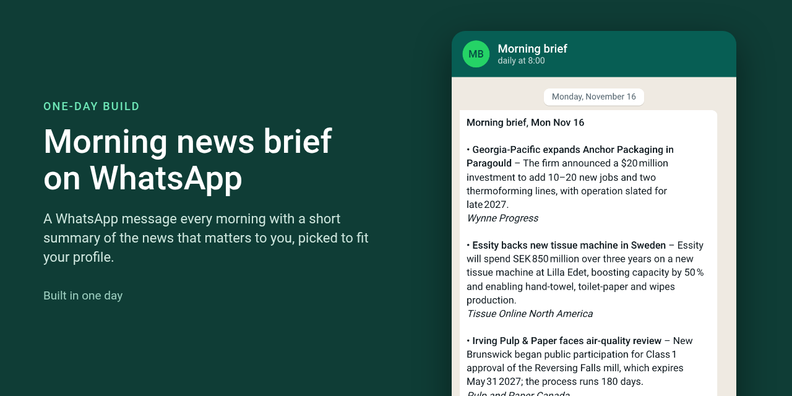
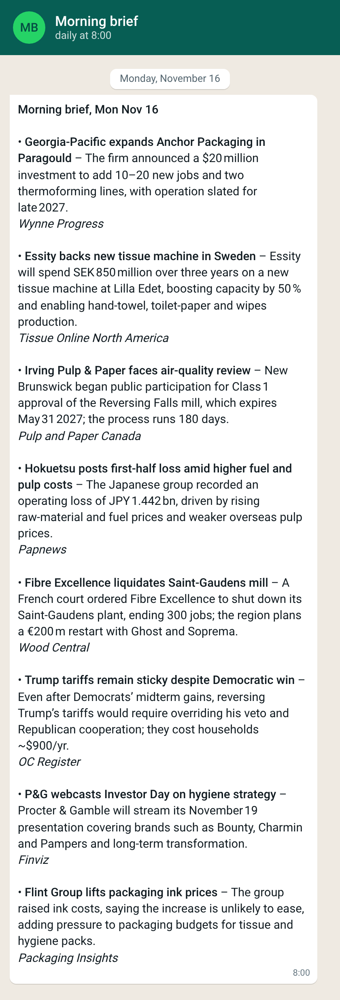
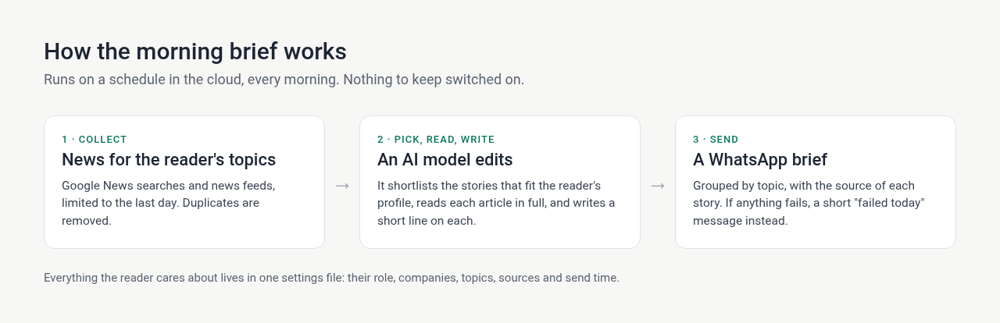

# Morning news brief on WhatsApp

**English** · [Español](README.es.md)

A WhatsApp message every morning with a short summary of the news that matters to you, picked to fit your profile.



**Built in one day** · 16 Nov 2026 · $0 a month to run

## The prompt

> I want an app that every day in the morning sends me a whatsapp with a brief summary of the news relevant to me.

## What it does

- Every morning, it collects the last day's news on the reader's topics.
- An AI model picks the stories that matter to this reader, reads the articles in full and writes a short line on
  each, with the source and a link.
- It sends the brief on WhatsApp. If anything fails, a short "Morning brief failed today" message arrives
  instead, so a failure is never mistaken for a quiet news day.

## A real brief

Written by the app on the day it was built, for a test profile: a manager at a US pulp and paper company who works
on tissue and hygiene products and follows pulp prices, competitors, new mills and closures, retail and private
label, costs, tariffs and regulation. The link under each story is left out of this image.



<details>
<summary>The full profile, as written in the settings</summary>

```
I am a manager at a US pulp and paper company, focused on tissue (bath tissue,
paper towels, napkins, facial) and sanitary/hygiene products (diapers, feminine
care, adult incontinence, wipes). I care about:
- Pulp markets: NBSK, hardwood/eucalyptus (BEK) and fluff pulp prices, supply, mill outages
- Competitors and big players: Kimberly-Clark, P&G (Charmin, Bounty, Pampers),
  Georgia-Pacific, Essity, Clearwater Paper, Sofidel, First Quality, Cascades,
  Kruger, Irving, Suzano, CMPC, Domtar/Paper Excellence, Mercer, Resolute
- New tissue machines, capacity additions, mill closures and curtailments in North America
- Retail and private label: Walmart, Costco, Target, Amazon, store-brand share, consumer demand
- Costs: energy and natural gas, freight, chemicals, packaging, labor
- Trade policy and tariffs affecting pulp, paper and hygiene products (Canada, Brazil, Mexico)
- Regulation: forestry, EPA, PFAS, recycled content, extended producer responsibility
- Earnings and M&A in tissue, hygiene and pulp
Skip generic stock-market chatter, printing/writing paper and graphic paper unless
it affects pulp supply, and anything that is not news (ads, product pages, evergreen articles).
```

</details>

## How it works



- **Collect:** Google News searches and news feeds for the reader's topics, limited to the last 26 hours, with
  duplicates removed.
- **Pick:** the AI model reads all the headlines against the reader's profile, drops the noise and duplicate
  coverage, and shortlists the stories worth reading.
- **Read and write:** the app opens each shortlisted article and reads it in full, then the AI model writes the
  brief from the articles themselves. It uses free models by default and tries the next one if a model is down;
  Claude can be switched on instead (paid).
- **Send:** through CallMeBot (free, for personal use) or Twilio.
- **Schedule:** runs every morning on GitHub Actions, so no computer or server has to stay on.

Everything the reader cares about is in one settings file: their role, the companies and topics to follow, the
news sources, how many stories, links on or off, language and send time.

## Setting it up

About 15 minutes, done once by the client, with step-by-step instructions:

1. Create a free OpenRouter key (for the AI model).
2. Send one WhatsApp message to CallMeBot to get a free sending key.
3. Add both keys to a private GitHub repository and press "Run workflow" for a test brief.

## Cost to run

$0 a month at one brief a day: free AI models, free CallMeBot, and GitHub Actions' free minutes.

## Want an app like this?

I build custom apps like this one in a day, for 100 USD. [Tell me what you need](https://cristiandesivo.com/apps-in-a-day/).

---

© 2026 Cristian Desivo. All rights reserved. · [More one-day builds](../../README.md)
